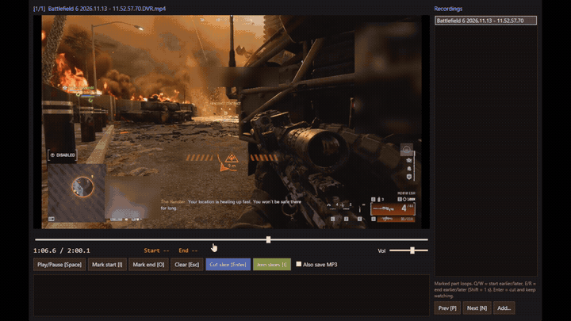

# FragCut

FragCut is a small Windows tool for cutting clips out of game recordings and joining them into one video.

You open a recording from the right-click menu, watch it, mark where a clip starts and ends, and press Enter to save it. When you have a few clips, press J to join them.

It works with any MP4 or MKV recording (NVIDIA App / ShadowPlay, Xbox Game Bar, AMD ReLive, OBS, Steam). It uses [ffmpeg](https://ffmpeg.org) to do the actual cutting, and encodes on your graphics card if it can.

Requires Windows 10 or 11.

## Install

1. Download `FragCut-vX.Y.Z.zip` from [Releases](https://github.com/tsufbarkai/fragcut/releases/latest) and unzip it.
2. Double-click `Install.bat`.
   - If Windows shows "Windows protected your PC", click **More info** and then **Run anyway**. This appears because FragCut isn't code-signed.
   - If ffmpeg isn't installed, the installer asks to install it for you (using `winget`).
3. Right-click a recording and choose **Send to → FragCut**.
   On Windows 11, *Send to* is under **Show more options**, or hold Shift while right-clicking.

FragCut installs into `%LOCALAPPDATA%\FragCut` and doesn't need admin rights.

To update, download the new zip and run `Install.bat` again. Your clips and settings are kept.

## Using FragCut

Right-click one or more recordings and choose **Send to → FragCut**. The video starts playing.

To save a clip:

1. Press `I` where the clip should start.
2. Press `O` where it should end. That part now plays on repeat, so you can check it.
3. If it's not quite right, move the start with `Q` / `W` and the end with `E` / `R`.
4. Press `Enter` to save it. The video keeps playing, and the clip is saved in the background.

Clips are saved next to the recording, named like `<recording> - clip 01m38-01m43.mp4`. Tick **Also save MP3** if you also want the audio as a separate file.

All keys:

| Key | What it does |
|---|---|
| `Space` | play / pause |
| `←` / `→` | back / forward 0.5 s (with `Shift`: 5 s, with `Ctrl`: 30 s) |
| `,` / `.` | one frame back / forward |
| `I` / `O` | mark start / mark end |
| `Q` / `W` | move the start earlier / later by 0.2 s (with `Shift`: 1 s) |
| `E` / `R` | move the end earlier / later by 0.2 s (with `Shift`: 1 s) |
| `Enter` or `C` | save the clip (if only a start is marked, it cuts up to the current position) |
| `Esc` | clear the marks |
| `J` | join the clips you saved |
| `K` | find kills (Battlefield 6), then jump to the next kill (`Shift+K`: previous) |
| `P` / `N` | previous / next recording |
| `↑` / `↓` | playback speed (0.25x to 4x) |
| `+` / `-` | volume |

You can also click the timeline to jump to a spot, or drag it. If you opened several recordings, they're listed on the right; click one to switch.

### Finding kills (Battlefield 6)

Press `K` (or **Find kills**). FragCut looks through the recording for the tags Battlefield 6 shows when you get a kill (KILL, HEADSHOT, KILL CONFIRMED) and puts a red mark on the timeline for each one. You can keep watching while it looks; a 2-minute recording takes about 10 seconds.

After that, `K` jumps to the next kill and marks it: 8 seconds before the kill to 2 seconds after, playing on repeat. Adjust it with `Q W E R` if needed and press `Enter` to save it. `Shift+K` goes to the previous kill.

Kills close together (a double kill, a squad wipe) count as one moment. FragCut remembers what it found, so opening the same recording again doesn't search it again.

It only knows Battlefield 6 for now, and the recording has to be 16:9 (1080p, 1440p, 4K, 720p ...).

### Kill montage (Battlefield 6)

Select one or more recordings and choose **Send to → FragCut - Kill montage**. It finds the kills in each recording, takes 5 seconds before each kill and 1 second after, and joins all of them into one video named `<first recording> - kill montage.mp4`. Nothing to click in between; it shows its progress in a small window.

Kills close together share one clip, so a double kill isn't repeated. If some recordings are 720p and others 1440p, the clips are scaled to the bigger size. Recordings that were already searched (with `K` or an earlier montage) aren't searched again.

### Joining clips

Press `J` in FragCut, or select clips in Explorer and choose **Send to → FragCut - Join clips**.

It lists the clips in the order they were recorded. Press Enter to keep that order, or type a different one, like `3 1 2` (leave a number out to skip that clip). The result is saved as `<first recording> - montage.mp4`.

Clips made by FragCut are joined without re-encoding, so it takes a second and the quality doesn't change. Clips with different resolutions or frame rates are re-encoded so they fit together.

### Cutting by typed times

If you already know the times, choose **Send to → FragCut - Cut by time** and type the start and end, for example `1:38` and `1:43`. It saves an MP4 and an MP3.

### Making a video smaller

Select one or more videos and choose **Send to → FragCut - Compress**. It saves a copy named `<name> - compressed.mp4`, usually about half the size, and leaves the original as it is. The quality drop is small. In a test on a 1440p game montage it was hard to notice while watching.

## Questions

**The video is black or won't play.**
The recording is probably HEVC (H.265) or AV1. Install *HEVC Video Extensions* or *AV1 Video Extension* from the Microsoft Store, or set your recorder to H.264. Cutting still works without them; only the preview needs them.

**Does it use my graphics card?**
Yes, if it can: NVIDIA, then AMD, then Intel. If none of them work, it uses the CPU, which is slower. The window title shows which one is used.

**Why does saving a clip take longer when OBS is open?**
OBS and FragCut use the same video encoder on the graphics card. If FragCut saved at full speed, an OBS recording running at the same time could stutter. So while OBS is open, FragCut saves clips more slowly to leave room for it.

**Find kills misses kills or finds none.**
It recognizes the white KILL / HEADSHOT / KILL CONFIRMED tags that appear left of and below the crosshair, so it needs those on screen: the default HUD layout and size, a 16:9 recording, and Battlefield 6. Kills you see while spectating a teammate are found too, since the game shows their tags.

**Does it upload anything?**
No. Everything happens on your PC.

**How do I uninstall it?**
Run `Uninstall.bat` (it's in the zip and in `%LOCALAPPDATA%\FragCut`). Your clips are not deleted.

## How it works

FragCut is a few PowerShell scripts. The player window uses WPF and Windows' built-in video playback. ffmpeg does the cutting, joining and compressing.

Every clip is encoded with the same settings (H.264 video, AAC 48 kHz stereo audio). That's why clips can be joined without re-encoding.

| File | What it does |
|---|---|
| `FragCut.ps1` | the player: watch, mark, cut |
| `Join.ps1` | join clips |
| `TimeCut.ps1` | cut by typed times |
| `Compress.ps1` | make a smaller copy of a video |
| `Kills.ps1` | find kills: ffmpeg reads the tag area 5 times a second, a small C# matcher compares it with the pictures in `kills\` |
| `KillScan.ps1` | list the kills in recordings from the command line |
| `KillMontage.ps1` | find the kills in recordings and join them into one video |
| `kills\bf6\` | pictures of the Battlefield 6 kill tags |
| `Core.ps1` | shared code (encoder detection, file names, ffmpeg settings) |
| `Install.ps1` / `Uninstall.ps1` | add / remove the Send to and Desktop shortcuts |

## License

[MIT](LICENSE). ffmpeg isn't included. It's installed separately and has its own license (LGPL/GPL).
