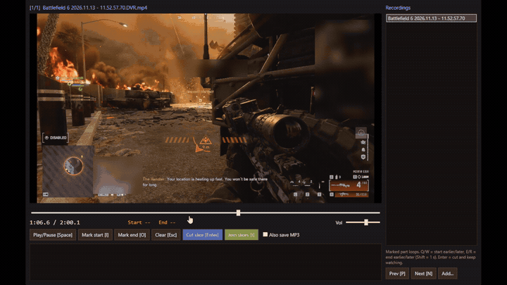

# FragCut

FragCut is a small Windows tool for cutting clips out of game recordings and joining them into one video.

You open a recording from the right-click menu, watch it, mark where a clip starts and ends, and press Enter to save it. When you have a few clips, press J to join them.



It works with any MP4 or MKV recording (NVIDIA App / ShadowPlay, Xbox Game Bar, AMD ReLive, OBS, Steam). It uses [ffmpeg](https://ffmpeg.org) to do the actual cutting, and encodes on your graphics card if it can. To play the recordings it uses [mpv](https://mpv.io), if it's installed.

Requires Windows 10 or 11.

## Install

1. Download `FragCut-vX.Y.Z.zip` from [Releases](https://github.com/tsufbarkai/fragcut/releases/latest) and unzip it.
2. Double-click `Install.bat`.
   - If Windows shows "Windows protected your PC", click **More info** and then **Run anyway**. This appears because FragCut isn't code-signed.
   - A window opens. It shows whether the two free programs FragCut uses are installed: **ffmpeg** (required, does the cutting) and **mpv** (recommended, plays the recordings, including AV1 and HEVC). Leave the missing ones ticked and click **Install**. ffmpeg is installed with `winget`. mpv is downloaded from its [official Windows builds](https://github.com/shinchiro/mpv-winbuild-cmake/releases) into FragCut's folder, after checking the file's published SHA-256 checksum.
3. Open **FragCut** from the Desktop, click **Set folder...** and pick the folder your recordings are saved in (for example `Videos\NVIDIA\Battlefield 6`). FragCut opens that folder from then on.
   You can also right-click recordings or a folder and choose **Send to → FragCut**. On Windows 11, *Send to* is under **Show more options**, or hold Shift while right-clicking.

FragCut installs into `%LOCALAPPDATA%\FragCut` and doesn't need admin rights.

To update, download the new zip and run `Install.bat` again. Your clips and settings are kept.

## Using FragCut

Open FragCut. The list on the right shows the recordings in your folder, and the newest one is loaded. Click a recording to play it.

To save a clip:

1. Press `I` where the clip should start.
2. Press `O` where it should end. That part now plays on repeat, so you can check it.
3. If it's not quite right, move the start with `Q` / `W` and the end with `E` / `R`, or drag the ends of the orange bar above the timeline.
4. Press `Enter` to save it. The video keeps playing, and the clip is saved in the background.

Clips are saved in a `clips` folder next to the recording, named like `<recording> - clip 01m38-01m43.mp4`. Tick **Also save MP3** if you also want the audio as a separate file.

### Fast cut

Normally each clip is encoded as H.264. If you tick **Fast cut (no re-encode)**, FragCut copies the clip out of the recording instead. It's saved in under a second, has the recording's quality, and takes the same space per second as the recording.

A copied clip has to start on a keyframe (a full picture in the video). Recordings usually have one every 0.5 to 2 seconds; OBS can be set to longer. So with fast cut, the start mark moves back to the keyframe at or before where you pressed `I`, and `Q` / `W` move the start to the previous / next keyframe. The end can be anywhere.

The clip stays in the recording's format. If you record in AV1 or HEVC, the clip is AV1 or HEVC too, and some apps (and Windows' own player) can't play it. Leave fast cut off for clips you want to share widely.

All keys:

| Key | What it does |
|---|---|
| `Space` | play / pause |
| `←` / `→` | back / forward 0.5 s (with `Shift`: 5 s, with `Ctrl`: 30 s) |
| `,` / `.` | one frame back / forward |
| `I` / `O` | mark start / mark end |
| `Q` / `W` | move the start earlier / later by 0.2 s (with `Shift`: 1 s) |
| `E` / `R` | move the end earlier / later by 0.2 s (with `Shift`: 1 s) |
| `Enter` or `C` | save the clip (if only a start is marked, it cuts up to the current position) |
| `Esc` | clear the marks |
| `J` | join the clips in the clip list |
| `K` | find kills (Battlefield 6), then jump to the next kill (`Shift+K`: previous) |
| `P` / `N` | previous / next recording |
| `↑` / `↓` | playback speed (0.25x to 4x) |
| `+` / `-` | volume |

You can also click the timeline to jump to a spot, or drag it. The orange bar above it shows the marked part; drag its left or right end to move the start or end.

### The recordings list

The list shows the folder you picked with **Set folder...**, oldest first:

- A round is one line, like `▸ BF6-12 2026-11-13 (2)`. Click it to open or close it. The round of the recording that plays opens by itself.
- Recordings that aren't in a round yet are yellow.
- With **Show clips** ticked, clips are listed in italics under the recording they were cut from. Montages are under their round, or at the end of the list. Click a clip to play it.
- **Delete...** moves the selected recordings or clips to the Recycle Bin, after asking. A clip's MP3 goes with it.
- Right-click for **Play**, **Add to clip list**, **Make round...**, **Show in folder** and **Delete**.

Ctrl+click or Shift+click selects several.

### Rounds

To keep the recordings of one game round together, select them in the list (Ctrl+click or Shift+click) and click **Make round...**. FragCut asks for a short game tag, like `BF6`, and suggests the next round number. It shows the new names before anything is moved. Then it:

- makes a folder for the round next to the recordings, named `BF6-12 2026-11-13` (tag, round number, date of the first recording),
- moves the recordings into it, renamed `BF6-12-1 <original name>`, `BF6-12-2 <original name>` ... in the order they were recorded,
- moves the clips already cut from them into the round's `clips` folder, renamed `BF6-12-1 clip 01m38-01m43.mp4`.

```
Battlefield 6\
  BF6-12 2026-11-13\
    BF6-12-1 Battlefield 6 2026.11.13 - 18.19.09.77.DVR.mp4
    BF6-12-2 Battlefield 6 2026.11.13 - 18.26.22.78.DVR.mp4
    clips\
      BF6-12-1 clip 01m38-01m43.mp4
      BF6-12 montage.mp4
```

Clips you cut later from those recordings get the same kind of name, and joining them gives `BF6-12 montage.mp4`. FragCut remembers the tag for each game folder and counts the rounds up from the highest one it finds.

**Undo round** moves the files of the last round back to their old names and folders. Clips cut since then go back with their recording.

### Finding kills (Battlefield 6)

Press `K` (or **Find kills**). FragCut looks through the recording for the tags Battlefield 6 shows when you get a kill (KILL, HEADSHOT, KILL CONFIRMED) and puts a red mark on the timeline for each one. You can keep watching while it looks; a 2-minute recording takes about 10 seconds.

After that, `K` jumps to the next kill and marks it: 8 seconds before the kill to 2 seconds after, playing on repeat. Adjust it with `Q W E R` if needed and press `Enter` to save it. `Shift+K` goes to the previous kill.

Kills close together (a double kill, a squad wipe) count as one moment, and its clip runs until 2 seconds after the last of them. FragCut remembers what it found, so opening the same recording again doesn't search it again.

It only knows Battlefield 6 for now, and the recording has to be 16:9 (1080p, 1440p, 4K, 720p ...).

### Kill montage (Battlefield 6)

Select one or more recordings and choose **Send to → FragCut - Kill montage**. It finds the kills in each recording, takes 5 seconds before each kill and 1 second after, and joins all of them into one video named `<first recording> - kill montage.mp4` (or `BF6-12 kill montage.mp4` for a round), in the `clips` folder. Nothing to click in between; it shows its progress in a small window.

Kills close together share one clip, so a double kill isn't repeated or cut short: when KILL turns into KILL x2, the clip runs until 1 second after the last kill. If some recordings are 720p and others 1440p, the clips are scaled to the bigger size. Recordings that were already searched (with `K` or an earlier montage) aren't searched again.

### Joining clips

Clips you cut are added to the clip list at the bottom of the window. You can also add older clips: right-click them in the recordings list and choose **Add to clip list**. In the clip list:

- **Play** (or double-click) plays a clip,
- **Up** / **Down** change the order,
- **Remove** takes a clip off the list and **Clear list** empties it (the files stay).

Press `J` (or **Join slices**) to join the saved clips, top to bottom. It runs inside FragCut, and the list is emptied when it's done. The result is saved next to the clips as `<first recording> - montage.mp4`, or `BF6-12 montage.mp4` for a round.

You can also select clips in Explorer and choose **Send to → FragCut - Join clips**. That opens a console window that lists the clips in the order they were recorded. Press Enter to keep that order, or type a different one, like `3 1 2` (leave a number out to skip that clip). The result is saved as `<first recording> - montage.mp4`.

Clips made by FragCut are joined without re-encoding, so it takes a second and the quality doesn't change. This also works for fast-cut clips from recordings with the same settings. Clips with different resolutions, frame rates or formats (for example a fast-cut AV1 clip and an H.264 clip) are re-encoded so they fit together.

### Cutting by typed times

If you already know the times, choose **Send to → FragCut - Cut by time** and type the start and end, for example `1:38` and `1:43`. It saves an MP4 and an MP3.

### Making a video smaller

Select one or more videos and choose **Send to → FragCut - Compress**. It saves a copy named `<name> - compressed.mp4`, usually about half the size, and leaves the original as it is. The quality drop is small. In a test on a 1440p game montage it was hard to notice while watching. AV1, HEVC and VP9 videos are skipped, because they're already more compact than the H.264 copy Compress makes.

## Questions

**Why is a clip bigger per second than my recording?**
FragCut saves clips as H.264, which plays everywhere and lets clips join without re-encoding. If you record in AV1 or HEVC, H.264 needs more data for the same picture, so a clip may use up to 1.5 times the recording's bitrate (1.2 times for H.264 recordings, never more than 40 Mbit/s). In a test on a 1440p60 AV1 recording, clips at that limit scored 97.9 out of 100 (VMAF) against the original.

**Why does a fast-cut clip start a bit before my mark?**
A copied clip can only start on a keyframe, so FragCut starts it on the last keyframe before your mark. The loop and the orange bar show the real start. To start exactly on your mark, turn fast cut off for that clip.

**Which player does FragCut use?**
mpv, if it's installed (the window title says "player: mpv"). It plays H.264, HEVC, AV1 and VP9 recordings and decodes them on the graphics card. Without mpv, FragCut uses the player built into Windows.

**It says "making a preview copy" when I open a recording.**
This only happens without mpv. Windows' player can't play some recordings, often AV1 or HEVC (H.265). FragCut then makes an H.264 copy of the recording, up to 1080p, and plays that instead. It takes a few seconds for a short recording and several minutes for a long one, and is only made once. Clips are still cut from the original, so their quality isn't affected. The copies are kept in `%LOCALAPPDATA%\FragCut\preview` (the 8 most recent). To skip this, install mpv by running `Install.bat` again.

**Does it use my graphics card?**
Yes, if it can: NVIDIA, then AMD, then Intel. If none of them work, it uses the CPU, which is slower. The window title shows which one is used.

**Why does saving a clip take longer when OBS is open?**
OBS and FragCut use the same video encoder on the graphics card. If FragCut saved at full speed, an OBS recording running at the same time could stutter. So while OBS is open, FragCut saves clips more slowly to leave room for it.

**Find kills misses kills or finds none.**
It recognizes the white KILL / HEADSHOT / KILL CONFIRMED tags that appear left of and below the crosshair, so it needs those on screen: the default HUD layout and size, a 16:9 recording, and Battlefield 6. Kills you see while spectating a teammate are found too, since the game shows their tags.

**Does it upload anything?**
No. Everything happens on your PC.

**How do I uninstall it?**
Run `Uninstall.bat` (it's in the zip and in `%LOCALAPPDATA%\FragCut`). Your clips are not deleted. The copy of mpv in FragCut's folder is removed with it. ffmpeg stays installed; remove it with `winget uninstall Gyan.FFmpeg.Essentials`.

## How it works

FragCut is a few PowerShell scripts. The player window uses WPF. The video in it is mpv, started inside the window and controlled through mpv's JSON pipe, or Windows' built-in video playback when mpv isn't installed. ffmpeg does the cutting, joining and compressing.

Every clip is encoded with the same settings (H.264 High profile level 5.2, AAC 48 kHz stereo audio). That's why clips can be joined without re-encoding. Only the bitrate limit differs, depending on the recording.

| File | What it does |
|---|---|
| `FragCut.ps1` | the player: watch, mark, cut |
| `Mpv.ps1` | runs mpv inside the player window |
| `Rounds.ps1` | the recordings list (rounds, recordings, clips), Make round and Undo round (moves and renames files, keeps a log in `%LOCALAPPDATA%\FragCut\rounds-log.json`), Delete |
| `Join.ps1` | join clips |
| `TimeCut.ps1` | cut by typed times |
| `Compress.ps1` | make a smaller copy of a video |
| `Kills.ps1` | find kills: ffmpeg reads the tag area 5 times a second, a small C# matcher compares it with the pictures in `kills\` |
| `KillScan.ps1` | list the kills in recordings from the command line |
| `KillMontage.ps1` | find the kills in recordings and join them into one video |
| `kills\bf6\` | pictures of the Battlefield 6 kill tags |
| `Core.ps1` | shared code (encoder detection, file names, ffmpeg settings) |
| `Install.ps1` / `Uninstall.ps1` | install window (copies FragCut, installs ffmpeg with winget, downloads mpv, adds the Send to and Desktop shortcuts) / remove it |

## License

[MIT](LICENSE). ffmpeg and mpv aren't included. They're installed separately and have their own licenses (LGPL/GPL).
